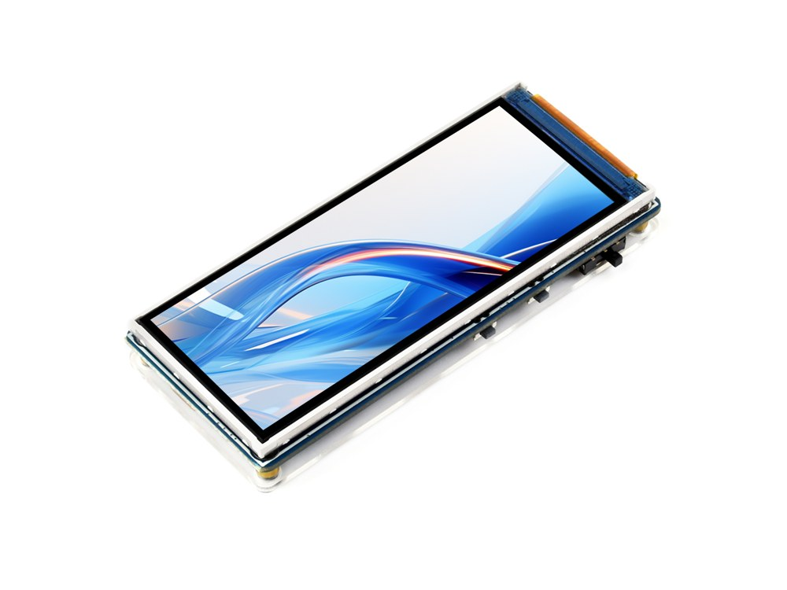

  <h1>ESP32-S3-LCD-3.16</h1>
  
<strong>ESP32-S3 3.16-inch 320 x 820 RGB LCD development board</strong>

  
<strong>English</strong> | <a href="README_ZH.md">简体中文</a>

  

    
    
    
  

  

    <a href="https://www.waveshare.com/esp32-s3-lcd-3.16.htm">🛒 Product</a> &middot;
    <a href="https://github.com/waveshareteam/ESP32-S3-LCD-3.16/releases/latest">📦 Firmware</a> &middot;
    <a href="examples/esp-idf/">🧩 ESP-IDF</a> &middot;
    <a href="examples/arduino/examples/">🔧 Arduino</a> &middot;
    <a href="https://www.waveshare.com/wiki/ESP32-S3-LCD-3.16">📖 Documentation</a>
  

  

---

## ✨ Overview

This ESP32-S3 development board combines a narrow RGB LCD with RTC, IMU and microSD storage. This repository provides ESP-IDF and Arduino examples, a factory test project and official hardware references.

| Feature | Device / interface |
| --- | --- |
| MCU | ESP32-S3R8 |
| Memory | 16 MB Flash, 8 MB PSRAM |
| Display | 3.16-inch LCD, 320 × 820, RGB565, ST7701 |
| RTC / IMU | PCF85063 / QMI8658 |

## 📦 Quick Start

After a release is published, download a ready-to-flash package from the
[latest release](https://github.com/waveshareteam/ESP32-S3-LCD-3.16/releases/latest). Before the first release, use a successful [Build run](https://github.com/waveshareteam/ESP32-S3-LCD-3.16/actions/workflows/build.yml) or build from source using the example README.

1. Download the `*-combined.zip` package for the example and framework version you need.
2. Extract the archive and install esptool with `python -m pip install esptool`.
3. Connect the board over USB.
4. Run `flash_combined.bat COMx` on Windows or `./flash_combined.sh /dev/ttyACM0` on Linux.
5. Reset the board if it does not restart automatically.

Factory firmware (restores the out-of-box demo): download the file whose name contains `FactoryOnly` from the [`firmware`](firmware/) folder.

## 🧪 Examples

### ESP-IDF

| Example | Main feature |
| --- | --- |
| [01_ADC_Test](examples/esp-idf/01_ADC_Test/) | Reads the onboard battery-voltage divider through ADC and prints raw readings and calculated voltage. |
| [02_I2C_PCF85063](examples/esp-idf/02_I2C_PCF85063/) | Sets and reads the onboard PCF85063 real-time clock. |
| [03_I2C_QMI8658](examples/esp-idf/03_I2C_QMI8658/) | Reads acceleration and angular velocity from the onboard QMI8658 IMU. |
| [04_SD_Card](examples/esp-idf/04_SD_Card/) | Mounts a microSD card and reports card information and capacity. |
| [05_WIFI_AP](examples/esp-idf/05_WIFI_AP/) | Creates a 2.4 GHz Wi-Fi access point and reports connected stations. |
| [06_WIFI_STA](examples/esp-idf/06_WIFI_STA/) | Connects to a 2.4 GHz Wi-Fi network and prints the assigned IP address. |
| [07_LVGL_V8_Test](examples/esp-idf/07_LVGL_V8_Test/) | Runs the LVGL 8 music interface on the RGB LCD. |
| [08_LVGL_V9_Test](examples/esp-idf/08_LVGL_V9_Test/) | Runs the LVGL 9 music interface on the RGB LCD. |

### Arduino

| Example | Main feature |
| --- | --- |
| [01_ADC_Test](examples/arduino/examples/01_ADC_Test/) | Reads the onboard battery-voltage divider through ADC and prints raw readings and calculated voltage. |
| [02_PCF85063_Test](examples/arduino/examples/02_PCF85063_Test/) | Sets and reads the onboard PCF85063 real-time clock. |
| [03_QMI8658_Test](examples/arduino/examples/03_QMI8658_Test/) | Reads acceleration and angular velocity from the onboard QMI8658 IMU. |
| [04_SD_Card](examples/arduino/examples/04_SD_Card/) | Mounts a microSD card and reports card information and capacity. |
| [05_WIFI_AP](examples/arduino/examples/05_WIFI_AP/) | Creates a 2.4 GHz Wi-Fi access point and reports connected stations. |
| [06_WIFI_STA](examples/arduino/examples/06_WIFI_STA/) | Connects to a 2.4 GHz Wi-Fi network and prints the assigned IP address. |
| [07_LVGL_V8_Test](examples/arduino/examples/07_LVGL_V8_Test/) | Runs the LVGL 8 music interface on the RGB LCD. |
| [08_LVGL_V9_Test](examples/arduino/examples/08_LVGL_V9_Test/) | Runs the LVGL 9 music interface on the RGB LCD. |

Libraries used by the sketches are bundled in [`examples/arduino/libraries`](examples/arduino/libraries/).

## 🛠️ Development Environment

| Framework | Version | Examples |
| --- | --- | ---: |
| ESP-IDF | `v5.5.6`, `v6.1.1` | 8 |
| Arduino-ESP32 | `3.3.12` | 7 |

The factory test project uses ESP-IDF `v5.3.2`; see [`examples/factory`](examples/factory/).

## 📚 Resources

- [Schematic](hardware/schematic/)
- [Product page](https://www.waveshare.com/esp32-s3-lcd-3.16.htm)
- [Wiki](https://www.waveshare.com/wiki/ESP32-S3-LCD-3.16)

## 🤝 Support

- Example or repository problem: [open an issue](https://github.com/waveshareteam/ESP32-S3-LCD-3.16/issues/new/choose).
- Product usage, hardware or order questions: [Waveshare support](https://service.waveshare.com/).

## 📄 License

Apache License 2.0. See [LICENSE](LICENSE).
