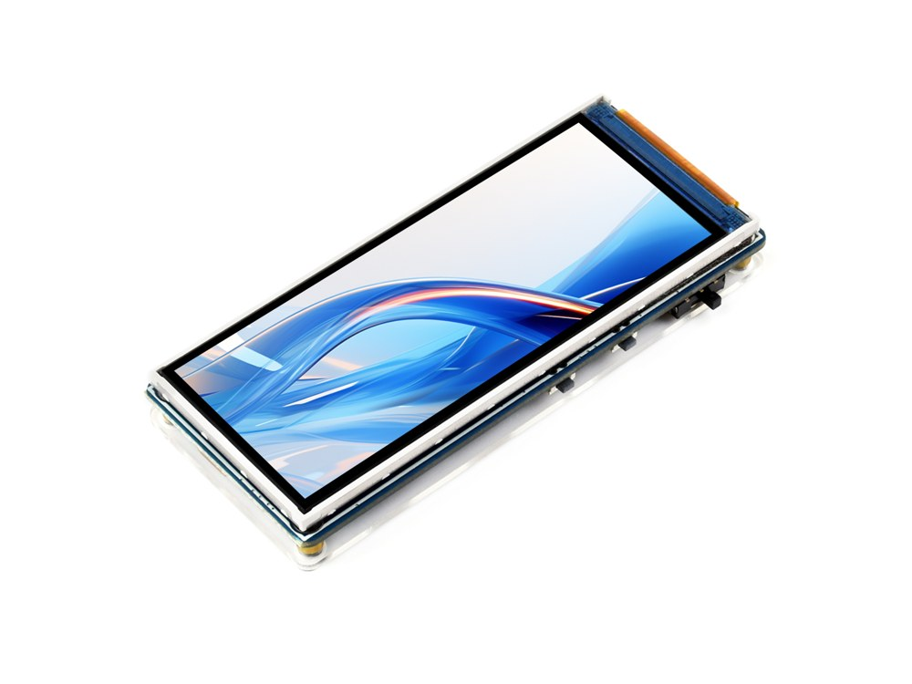

  <h1>ESP32-S3-LCD-3.16</h1>
  
<strong>ESP32-S3 3.16 英寸 320 × 820 RGB LCD 开发板</strong>

  
<a href="README.md">English</a> | <strong>简体中文</strong>

  

    
    
    
  

  

    <a href="https://www.waveshare.com/esp32-s3-lcd-3.16.htm">🛒 产品</a> &middot;
    <a href="https://github.com/waveshareteam/ESP32-S3-LCD-3.16/releases/latest">📦 固件</a> &middot;
    <a href="examples/esp-idf/">🧩 ESP-IDF</a> &middot;
    <a href="examples/arduino/examples/">🔧 Arduino</a> &middot;
    <a href="https://docs.waveshare.net/ESP32-S3-LCD-3.16/">📖 文档</a>
  

  

---

## ✨ 概述

这块 ESP32-S3 开发板集成窄长 RGB LCD、RTC、IMU 与 microSD 存储。本仓库提供 ESP-IDF、Arduino 示例、出厂测试工程及官方硬件资料。

| 功能 | 器件或接口 |
| --- | --- |
| MCU | ESP32-S3R8 |
| 存储器 | 16 MB Flash，8 MB PSRAM |
| 显示 | 3.16 英寸 LCD，320 × 820，RGB565，ST7701 |
| RTC / IMU | PCF85063 / QMI8658 |

## 📦 快速开始

发布后可使用[最新版本](https://github.com/waveshareteam/ESP32-S3-LCD-3.16/releases/latest)中的可烧录固件。首次发布前，可下载 [Build 工作流](https://github.com/waveshareteam/ESP32-S3-LCD-3.16/actions/workflows/build.yml) 成功运行的产物，或按示例说明从源码构建。

1. 下载所需示例和框架版本对应的 `*-combined.zip`。
2. 解压后通过 `python -m pip install esptool` 安装 esptool。
3. 通过 USB 连接开发板。
4. Windows 运行 `flash_combined.bat COMx`，Linux 运行 `./flash_combined.sh /dev/ttyACM0`。
5. 如果开发板未自动重启，请手动复位。

出厂固件（恢复开箱演示）：在 [`firmware`](firmware/) 目录下载文件名带 `FactoryOnly` 的文件。

## 🧪 示例

### ESP-IDF

| 示例 | 主要功能 |
| --- | --- |
| [01_ADC_Test](examples/esp-idf/01_ADC_Test/README_ZH.md) | 通过 ADC 采集板载电池电压分压信号，输出原始读数和换算电压。 |
| [02_I2C_PCF85063](examples/esp-idf/02_I2C_PCF85063/README_ZH.md) | 设置并读取板载 PCF85063 实时时钟。 |
| [03_I2C_QMI8658](examples/esp-idf/03_I2C_QMI8658/README_ZH.md) | 读取板载 QMI8658 IMU 的加速度和角速度。 |
| [04_SD_Card](examples/esp-idf/04_SD_Card/README_ZH.md) | 挂载 microSD 卡并输出卡片信息与容量。 |
| [05_WIFI_AP](examples/esp-idf/05_WIFI_AP/README_ZH.md) | 创建 2.4 GHz Wi-Fi 热点并输出客户端连接信息。 |
| [06_WIFI_STA](examples/esp-idf/06_WIFI_STA/README_ZH.md) | 连接 2.4 GHz Wi-Fi 网络并输出分配到的 IP 地址。 |
| [07_LVGL_V8_Test](examples/esp-idf/07_LVGL_V8_Test/README_ZH.md) | 在 RGB LCD 上运行 LVGL 8 音乐界面演示。 |
| [08_LVGL_V9_Test](examples/esp-idf/08_LVGL_V9_Test/README_ZH.md) | 在 RGB LCD 上运行 LVGL 9 音乐界面演示。 |

### Arduino

| 示例 | 主要功能 |
| --- | --- |
| [01_ADC_Test](examples/arduino/examples/01_ADC_Test/README_ZH.md) | 通过 ADC 采集板载电池电压分压信号，输出原始读数和换算电压。 |
| [02_PCF85063_Test](examples/arduino/examples/02_PCF85063_Test/README_ZH.md) | 设置并读取板载 PCF85063 实时时钟。 |
| [03_QMI8658_Test](examples/arduino/examples/03_QMI8658_Test/README_ZH.md) | 读取板载 QMI8658 IMU 的加速度和角速度。 |
| [04_SD_Card](examples/arduino/examples/04_SD_Card/README_ZH.md) | 挂载 microSD 卡并输出卡片信息与容量。 |
| [05_WIFI_AP](examples/arduino/examples/05_WIFI_AP/README_ZH.md) | 创建 2.4 GHz Wi-Fi 热点并输出客户端连接信息。 |
| [06_WIFI_STA](examples/arduino/examples/06_WIFI_STA/README_ZH.md) | 连接 2.4 GHz Wi-Fi 网络并输出分配到的 IP 地址。 |
| [08_LVGL_V9_Test](examples/arduino/examples/08_LVGL_V9_Test/README_ZH.md) | 在 RGB LCD 上运行 LVGL 9 音乐界面演示。 |

草图使用的库随仓库提供，位于 [`examples/arduino/libraries`](examples/arduino/libraries/)。

## 🛠️ 开发环境

| 开发框架 | 版本 | 示例数 |
| --- | --- | ---: |
| ESP-IDF | `v5.5.6`, `v6.1.1` | 8 |
| Arduino-ESP32 | `3.3.12` | 7 |

出厂测试工程使用 ESP-IDF `v5.3.2`，源码见 [`examples/factory`](examples/factory/README_ZH.md)。

## 📚 资料

- [原理图](hardware/schematic/)
- [产品页](https://www.waveshare.com/esp32-s3-lcd-3.16.htm)
- [Wiki](https://docs.waveshare.net/ESP32-S3-LCD-3.16/)

## 🤝 支持

- 产品使用、硬件或订单问题：[微雪技术支持](https://docs.waveshare.net/ESP32-S3-LCD-3.16/Technical-Support/)。

## 📄 许可证

Apache License 2.0，详见 [LICENSE](LICENSE)。
